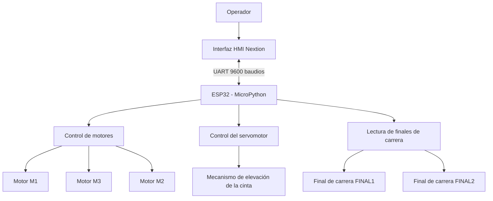
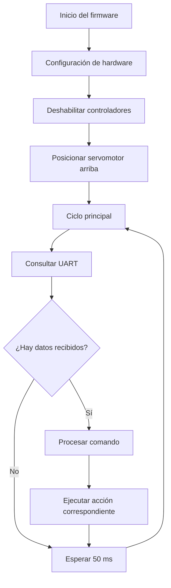
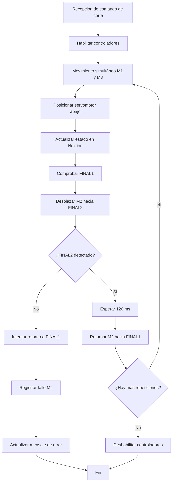

# Sistema de control para cortadora de cinta con ESP32

Sistema de automatización y control de una cortadora de cinta desarrollado mediante un microcontrolador **ESP32**, programado en **MicroPython**, con interfaz de operación implementada en una pantalla táctil **Nextion**.

El firmware permite gestionar los movimientos de los motores paso a paso, controlar el mecanismo de elevación de la cinta mediante un servomotor, supervisar la posición del eje de corte mediante finales de carrera y configurar los parámetros de longitud y cantidad de cortes desde la interfaz gráfica.

---

## Tabla de contenido

- [1. Descripción del proyecto](#1-descripción-del-proyecto)
- [2. Objetivos](#2-objetivos)
- [3. Arquitectura general](#3-arquitectura-general)
- [4. Hardware del sistema](#4-hardware-del-sistema)
- [5. Asignación de pines](#5-asignación-de-pines)
- [6. Entorno de desarrollo](#6-entorno-de-desarrollo)
- [7. Organización del firmware](#7-organización-del-firmware)
- [8. Funcionamiento del sistema](#8-funcionamiento-del-sistema)
- [9. Comunicación con la pantalla Nextion](#9-comunicación-con-la-pantalla-nextion)
- [10. Parámetros de configuración](#10-parámetros-de-configuración)
- [11. Secuencia de operación](#11-secuencia-de-operación)
- [12. Consideraciones técnicas del firmware actual](#12-consideraciones-técnicas-del-firmware-actual)
- [13. Instalación y ejecución](#13-instalación-y-ejecución)

---

## 1. Descripción del proyecto

El proyecto consiste en el desarrollo de un sistema de control electrónico para una cortadora de cinta, utilizando un ESP32 como unidad principal de procesamiento.

El sistema integra motores paso a paso para el desplazamiento de los mecanismos de la máquina, un servomotor para el posicionamiento de la cinta de corte y sensores de final de carrera para supervisar los límites de desplazamiento del eje vertical.

La interacción con el operador se realiza mediante una pantalla Nextion, desde la cual es posible seleccionar modalidades de corte, modificar la longitud de trabajo, establecer la cantidad de cortes y visualizar información del proceso.

El firmware está desarrollado en MicroPython y se encarga de interpretar los comandos recibidos desde la interfaz, ejecutar las rutinas de movimiento y gestionar las señales de control de los actuadores.

## 2. Objetivos

### Objetivo general

Desarrollar un sistema de control electrónico basado en ESP32 para automatizar los movimientos y la operación de una cortadora de cinta, permitiendo configurar parámetros de trabajo desde una interfaz HMI.

### Objetivos específicos

- Controlar los motores paso a paso mediante señales STEP y DIR.
- Implementar rutinas de desplazamiento con rampas de velocidad.
- Controlar el posicionamiento de la cinta mediante un servomotor.
- Supervisar el desplazamiento del eje vertical mediante finales de carrera.
- Establecer comunicación serial entre el ESP32 y la pantalla Nextion.
- Permitir la configuración de longitud y cantidad de cortes.
- Gestionar los estados de operación y los errores detectados durante el movimiento del eje de corte.

## 3. Arquitectura general

El sistema se organiza alrededor del ESP32, que recibe instrucciones de la pantalla Nextion y ejecuta las rutinas de control correspondientes.

Los principales bloques funcionales son:

| Bloque | Función |
|---|---|
| ESP32 | Procesamiento y ejecución del firmware |
| Pantalla Nextion | Interfaz de operación y configuración |
| Controladores de motores | Gestión de corriente y movimiento de motores paso a paso |
| Motor M1 | Primer mecanismo de desplazamiento |
| Motor M3 | Segundo mecanismo de desplazamiento |
| Motor M2 | Movimiento del eje vertical de corte |
| Servomotor | Posicionamiento de la cinta de corte |
| Finales de carrera | Detección de los extremos del recorrido del eje vertical |

### Diagrama general de bloques

## 4. Hardware del sistema

Los componentes identificados en el firmware son:

| Componente | Descripción |
|---|---|
| ESP32 | Microcontrolador principal |
| Pantalla Nextion | Interfaz HMI |
| Motores paso a paso | Actuadores de desplazamiento |
| Drivers de motores | Etapas de potencia para los motores |
| Servomotor | Actuador para subir y bajar la cinta |
| Finales de carrera | Sensores de posición del eje M2 |

El código utiliza señales de habilitación, dirección y pulsos para controlar los motores paso a paso.

**Nota:** La referencia exacta de los motores, los controladores, la fuente de alimentación y las características eléctricas deben documentarse de acuerdo con los componentes instalados físicamente en la máquina.

## 5. Asignación de pines

La siguiente tabla corresponde a la configuración definida en el firmware.

| Señal | GPIO ESP32 | Descripción |
|---|---:|---|
| EN | 23 | Habilitación de los controladores |
| M1_STEP | 22 | Pulsos de movimiento del motor M1 |
| M1_DIR | 25 | Dirección del motor M1 |
| M3_STEP | 15 | Pulsos de movimiento del motor M3 |
| M3_DIR | 18 | Dirección del motor M3 |
| M2_STEP | 33 | Pulsos de movimiento del motor M2 |
| M2_DIR | 32 | Dirección del motor M2 |
| FINAL1 | 21 | Detección de posición inicial |
| FINAL2 | 12 | Detección de posición final |
| SERVO | 19 | Señal PWM del servomotor |
| UART TX | 27 | Transmisión hacia Nextion |
| UART RX | 26 | Recepción desde Nextion |

Los finales de carrera se configuran como entradas con resistencia interna pull-up. El firmware considera que un final de carrera está activo cuando su entrada presenta un nivel lógico bajo (`0`).

## 6. Entorno de desarrollo

### Tecnologías utilizadas

- **Microcontrolador:** ESP32.
- **Lenguaje de programación:** MicroPython.
- **Interfaz HMI:** Nextion.
- **Comunicación:** UART.
- **Control de motores:** Señales STEP/DIR.
- **Control del servomotor:** PWM.

### Bibliotecas principales

| Biblioteca | Utilización |
|---|---|
| `machine.Pin` | Configuración y control de entradas y salidas digitales |
| `machine.UART` | Comunicación serial con la pantalla |
| `machine.PWM` | Generación de señal PWM para el servomotor |
| `time` | Temporización y generación de retardos |

## 7. Organización del firmware

El firmware se encuentra organizado en bloques funcionales dentro del archivo principal.

### 7.1. Configuración de hardware

Define los pines utilizados por el ESP32 para controlar los motores, leer los finales de carrera, comunicarse con la pantalla y accionar el servomotor.

### 7.2. Control del servomotor

Las funciones relacionadas son:

- `activar_servo()`: inicializa la salida PWM a 50 Hz.
- `desactivar_servo()`: deshabilita la señal PWM.
- `mover_servo(duty)`: aplica el valor de trabajo indicado durante 400 ms.
- `servo_arriba()`: posiciona el servomotor utilizando el valor configurado para la posición superior.
- `servo_abajo()`: posiciona el servomotor utilizando el valor configurado para la posición inferior.

### 7.3. Comunicación con Nextion

La comunicación se realiza mediante UART2 a 9600 baudios.

La función `enviar_texto(obj, txt)` permite actualizar los campos de texto de la interfaz.

La función `leer_nextion()` consulta el buffer serial, procesa los datos recibidos y entrega el comando correspondiente a la función de interpretación.

### 7.4. Control de motores M1 y M3

El firmware utiliza la función `step_m1_m3(delay)` para generar pulsos simultáneos en las salidas STEP de ambos motores.

La función `mover_m1_m3_rampa(pasos)` establece las direcciones de movimiento, habilita los controladores y ejecuta una rampa de arranque. Posteriormente, genera los pulsos correspondientes a la cantidad de pasos solicitada.

**Comportamiento implementado:** M1 y M3 reciben los pulsos de movimiento simultáneamente. Aunque los mecanismos pueden tener funciones mecánicas independientes, el firmware actual no ejecuta una secuencia independiente entre ambos motores.

### 7.5. Control del motor M2

El motor M2 controla el desplazamiento del eje vertical.

Las funciones principales son:

- `step_m2(d)`: genera un pulso de movimiento con el intervalo indicado.
- `ir_a_final2()`: desplaza el eje hasta detectar el final de carrera FINAL2.
- `ir_a_final1()`: desplaza el eje hasta detectar el final de carrera FINAL1.
- `motor2_con_finales()`: coordina el desplazamiento entre ambos finales de carrera y gestiona el fallo cuando no se detecta FINAL2.

Las rutinas de búsqueda incorporan una etapa inicial de aceleración y un límite máximo de pasos para evitar que el movimiento continúe indefinidamente cuando no se detecta el sensor esperado.

### 7.6. Secuencia de corte

La función `ejecutar_corte(pasos, repeticiones)` coordina la ejecución del proceso.

Para cada repetición:

1. Ejecuta el desplazamiento de M1 y M3.
2. Acciona el servomotor para bajar la cinta.
3. Actualiza la información del proceso en la pantalla.
4. Ejecuta el ciclo de desplazamiento del motor M2 entre sus finales de carrera.

Al finalizar, deshabilita los controladores. Si se detecta un fallo de M2, actualiza las variables y los mensajes de la interfaz.

### 7.7. Gestión de comandos

La función `procesar_comando(cmd)` interpreta las instrucciones recibidas desde Nextion.

Dependiendo del comando, modifica los parámetros de trabajo, actualiza la interfaz o ejecuta una rutina de movimiento.

## 8. Funcionamiento del sistema

El firmware trabaja mediante un ciclo principal que consulta periódicamente la comunicación serial.

La estructura de ejecución es:

Al iniciar, el firmware configura las salidas, deshabilita los controladores de motores y posiciona el servomotor en la posición superior.

Posteriormente, entra en un ciclo continuo en el que consulta la comunicación serial y procesa los comandos recibidos desde la pantalla.

Cuando se recibe una instrucción de movimiento, se ejecuta la rutina correspondiente. Estas rutinas son bloqueantes: durante su ejecución, el ciclo principal no consulta nuevos comandos de la pantalla.

## 9. Comunicación con la pantalla Nextion

La comunicación entre el ESP32 y la pantalla se establece mediante UART2.

| Parámetro | Valor |
|---|---|
| Puerto | UART2 |
| Velocidad | 9600 baudios |
| TX ESP32 | GPIO 27 |
| RX ESP32 | GPIO 26 |

### Comandos implementados

| Comando | Acción |
|---|---|
| `iniciar` | Ejecuta el proceso con 40000 pasos y la cantidad configurada |
| `trescuartos` | Ejecuta el proceso con 40000 pasos |
| `uno` | Ejecuta el proceso con 30400 pasos |
| `perso` | Actualiza en pantalla la longitud y cantidad configuradas |
| `cant-` | Disminuye la cantidad de cortes |
| `cant+` | Incrementa la cantidad de cortes |
| `cm-` | Disminuye la longitud configurada |
| `cm+` | Incrementa la longitud configurada |
| `ok` | Ejecuta el corte con la longitud personalizada |
| `servoUp` | Posiciona el servomotor arriba |

Los comandos se reciben como cadenas de texto. Para las actualizaciones de pantalla se utiliza el formato de asignación de texto de Nextion, seguido de los tres bytes de terminación `0xFF`.

## 10. Parámetros de configuración

Los parámetros principales definidos en el firmware son:

| Parámetro | Valor | Descripción |
|---|---:|---|
| `PASOS_POR_CM` | 1600 | Factor utilizado para convertir centímetros en pasos |
| `PASOS_15CM_3_4` | 40000 | Valor calculado mediante 25 × 1600 |
| `PASOS_19CM_1IN` | 30400 | Valor calculado mediante 19 × 1600 |
| `vel_motor1` | 50 µs | Intervalo de los pulsos de M1 y M3 |
| `vel_arranque` | 800 µs | Intervalo inicial de la rampa de M1 y M3 |
| `vel_min` | 400 µs | Intervalo inicial de movimiento de M2 |
| `vel_max` | 80 µs | Intervalo mínimo utilizado por M2 |
| `acel_pasos` | 500 | Cantidad de pasos de la etapa inicial de M2 |
| `SERVO_ARRIBA` | 25 | Valor PWM configurado para la posición superior |
| `SERVO_ABAJO` | 40 | Valor PWM configurado para la posición inferior |
| `CM_MIN` | 5 | Longitud mínima configurable |
| `CANT_MIN` | 1 | Cantidad mínima de cortes |
| `MAX_PASOS` | 14000 | Límite de pasos en las rutinas de búsqueda de M2 |

Los valores PWM del servomotor corresponden a los parámetros definidos en el código y deben interpretarse de acuerdo con la implementación de PWM de la versión de MicroPython utilizada.

## 11. Secuencia de operación

La secuencia de corte implementada se resume de la siguiente manera:

**Importante:** El diagrama representa la secuencia general. El firmware no verifica el resultado del retorno a FINAL1 en `motor2_con_finales()`. Por tanto, la detección de FINAL2 no garantiza por sí sola que el eje haya regresado correctamente a su posición inicial.

## 12. Consideraciones técnicas del firmware actual

La documentación del sistema debe distinguir entre las funciones implementadas y las características que pueden incorporarse en futuras versiones.

### 12.1. Control sincronizado de M1 y M3

Actualmente, los dos motores reciben pulsos STEP simultáneos. La secuencia de desplazamiento independiente de M1 y M3 no está implementada en el código disponible.

### 12.2. Supervisión de M2

El desplazamiento del eje vertical utiliza dos finales de carrera y un límite de pasos para las rutinas de búsqueda.

El firmware contempla una condición de error cuando no se detecta FINAL2 dentro del límite establecido. Sin embargo, no comprueba el resultado de la rutina de retorno a FINAL1.

### 12.3. Ejecución bloqueante

Las funciones de movimiento y corte se ejecutan de forma secuencial y bloqueante. Durante estas operaciones, el programa no procesa nuevos comandos recibidos desde Nextion.

### 12.4. Posicionamiento del servomotor

El servomotor se posiciona arriba durante la inicialización y mediante el comando `servoUp`. Durante el ciclo de corte, se ordena bajar la cinta, pero el firmware no ejecuta automáticamente una orden de subida al finalizar cada repetición.

### 12.5. Seguridad

El firmware no implementa una entrada específica de parada de emergencia ni una supervisión independiente de seguridad para todos los ejes.

La protección de los operadores debe contemplar dispositivos físicos y circuitos de seguridad adecuados, independientes de la interfaz gráfica y del firmware de control.

## 13. Instalación y ejecución

### Requisitos

- Placa ESP32 compatible con MicroPython.
- Firmware MicroPython instalado en el ESP32.
- Pantalla Nextion configurada con los objetos y eventos correspondientes a los comandos del programa.
- Controladores de motores y actuadores conectados de acuerdo con la asignación de pines.
- Finales de carrera conectados a las entradas configuradas.

### Procedimiento

1. Instalar MicroPython en el ESP32.
2. Conectar la placa al computador mediante USB.
3. Abrir el entorno de desarrollo compatible con MicroPython.
4. Configurar la comunicación con el ESP32.
5. Cargar el archivo principal del firmware.
6. Verificar la conexión UART con la pantalla Nextion.
7. Comprobar individualmente los sensores, motores y servomotor antes de realizar pruebas de corte.

**Advertencia:** Antes de operar la máquina, verificar las conexiones eléctricas, la alimentación de los actuadores, el sentido de giro de los motores y el funcionamiento de los finales de carrera. Las primeras pruebas deben realizarse en condiciones controladas y con las medidas de protección correspondientes.

---

## Estado del proyecto

La documentación de este repositorio describe el funcionamiento del firmware proporcionado para el ESP32. Las características descritas como futuras mejoras no deben considerarse implementadas hasta que se incorporen al código y se validen mediante pruebas.

**Proyecto:** Sistema de control para cortadora de cinta  
**Plataforma:** ESP32  
**Firmware:** MicroPython  
**Interfaz:** Nextion HMI  
**Aplicación:** Automatización y control de mecanismos de corte